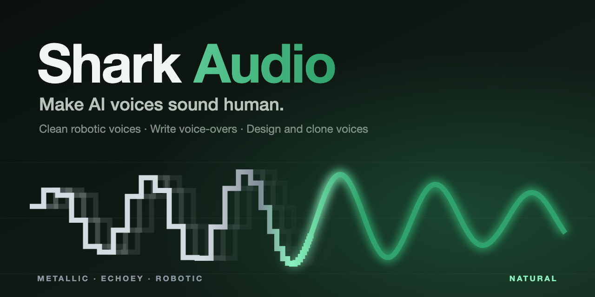

<p align="center">
  
</p>

# Voice Studio

**A voice production suite that runs on your own computer.** Fix robotic AI voices, write and render voice-overs
with captions, design new voices, and clone a voice from a few seconds of audio. Nothing is uploaded anywhere
unless you choose to connect an AI service for script writing.

- **Clean:** removes the metallic ringing, hollow "AI echo" and robotic buzz from AI voices in audio or video.
  Previews, matched-volume A/B listening, templates, batch processing. ([guide](docs/clean.md))
- **Studio:** multi-voice scripts with delivery styles, takes, pauses, pronunciation, **fit-to-time**, subtitle
  import and **timed video dubbing**, background music with ducking, captions (SRT/VTT), stems, and loudness
  targets for YouTube, podcasts, EBU R128 and audiobooks. An **AI script writer** and a speech-friendly rewriter
  help when you don't have a script. ([guide](docs/studio.md))
- **Voice Lab:** browse 54 built-in voices (star your favourites), design new ones by blending, describe a voice
  in words, or match a recording to the closest blend. ([guide](docs/voicelab.md))
- **Cloning:** zero-shot voice cloning from 5-60 seconds of audio, emotion tags (`[laugh]`, `[sigh]`...), a
  voice changer that re-voices your own performance, and cloned speech in Spanish, French, Italian and
  Portuguese. Consent is required. ([guide](docs/cloning.md))

Text-to-speech uses [Kokoro](https://github.com/hexgrad/kokoro) (Apache-2.0) and cloning uses
[Chatterbox-Turbo](https://github.com/resemble-ai/chatterbox) (MIT), both on the CPU. No GPU is needed.

> **Status:** early, built and tested on an Intel Mac (CPU only). Linux and Windows are untested. Voice quality
> results in the guides are measured with standard scores, not human listening tests, so please listen for yourself.

## Quick start

You need [uv](https://docs.astral.sh/uv/), [ffmpeg](https://ffmpeg.org/), and about 400 MB of disk
(3.3 GB more if you add cloning).

```sh
git clone https://github.com/g-baskin/voice-studio.git
cd voice-studio
uv sync                          # Python 3.12 environment
scripts/download_models.sh       # base models, ~385 MB, checksum-verified
uv run voicestudio serve --open  # opens http://127.0.0.1:8765
```

On a Mac you can also double-click **`desktop/Voice Studio.app`**, which starts the engine and opens the app in
its own window. Stop it with `desktop/Stop Voice Studio.command`.

**Optional: voice cloning** (about 3.3 GB, installed inside the project folder only):

```sh
scripts/setup_clone_engine.sh
```

Cloned speech takes roughly 4-5 seconds of computing per second of audio on a 4-core Intel CPU, plus about 20
seconds to warm up the first time.

## Connect an AI for script writing (optional)

Studio's **Write a script for me** and **Rewrite for speech** work without any AI: a built-in outline writer and
rules handle numbers, abbreviations and long sentences. To get fully written scripts, connect a language model.
Voice Studio talks to it through the official [OpenAI Python SDK](https://github.com/openai/openai-python), and
uses [OpenRouter](https://openrouter.ai) by default, which gives you one key for many models.

1. Create a key at https://openrouter.ai/keys.
2. Either paste it into **Studio > Write a script for me > Connect AI**, or set it before starting:
   ```sh
   export OPENROUTER_API_KEY=sk-or-...
   ```
3. The default model is `openai/gpt-4o-mini` (inexpensive). Change it in the same panel or with
   `NATURALVOICE_LLM_MODEL=anthropic/claude-haiku-5.5`, for example.

A key pasted into the app is tested with a tiny request, then saved to `data/llm.json` (readable only by you).
It is never sent back to the browser or written to logs. An `OPENROUTER_API_KEY` environment variable takes
precedence. Other options, checked in this order after OpenRouter: `OPENAI_API_KEY`, any OpenAI-compatible
server via `NATURALVOICE_LLM_URL` (LM Studio, vLLM...), or a local [Ollama](https://ollama.com) chat model.
When you use an AI service, the text of your brief or script is sent to that provider under its terms.

## Environment settings (optional)

**Core local use requires no environment variables.** [`.env.example`](.env.example) lists optional AI-service
keys, model choices, storage paths and cloning-worker settings. Voice Studio does **not** automatically load
`.env` files.

To use one, run `cp -n .env.example .env` from the project root (this keeps an existing `.env`). Edit `.env`,
uncomment only the settings you need, and replace their example values. Keep credentials in `.env`, which is
git-ignored; never commit them. Then start from the same terminal using Bash or Zsh:

```sh
set -a
. ./.env
set +a
uv run voicestudio serve --open
```

Only source a file you trust: the shell executes its contents. Quote values, especially paths with spaces.
These settings apply to this terminal and its child processes, not an app launched separately by double-clicking.
For a custom AI server, use `NATURALVOICE_LLM_KEY` for authentication; OpenRouter keys (including a saved UI key)
and `OPENAI_API_KEY` take priority over `NATURALVOICE_LLM_URL`.

## Command line

```sh
uv run voicestudio clean ad.mp4                                  # fix a robotic voice (audio or video)
uv run voicestudio speak "Hello there!" --voice af_heart -o hello.wav
uv run voicestudio voices --starred                              # list voices
uv run voicestudio render project.json --target podcast --stems  # render a saved Studio project
uv run voicestudio dub subs.srt --voice af_heart --video in.mp4  # dub a video from subtitles
uv run voicestudio bench --quick                                 # benchmark the cleanup (see docs/clean.md)
```

`naturalvoice` still works as the old name for the same command. Optional paid voice engines:
`ELEVENLABS_API_KEY` or `OPENAI_API_KEY` with `--engine elevenlabs|openai` (untested without keys).

## Responsible use

Voice cloning and the voice changer can imitate real people. Voice Studio asks you to confirm you own the voice
or have permission to use it, and enforces that on the server, but it can't verify your claim. Don't impersonate
people, deceive listeners, or break the law or platform rules. Label synthetic voices where required, and check
the licenses of the models you use before commercial use.

## Limits worth knowing

- It's a **local, single-user app with no login.** Keep it on `127.0.0.1`. Don't expose it to the internet.
- Cloning is English-first; other languages use a built-in voice's pronunciation re-voiced as the clone, not
  native multilingual cloning.
- "Describe a voice" and "Match" work within the 54 built-in voices; they don't generate new voices from scratch.
- Emotion tags add soft non-speech sounds (breaths, laughs); they are subtle, not acted emotion.
- Everything you create is stored in `data/` (git-ignored). Back it up if it matters.

## Development

The logo and banner are generated: `uv run python scripts/build_brand.py` writes the SVGs and
`PLAYWRIGHT_MODULE=/path/to/playwright node scripts/render_brand.cjs` renders the PNG icons and banner.

```sh
uv run pytest -q                        # ~110 tests, a few minutes (uses the real models)
PLAYWRIGHT_MODULE=/path/to/playwright NV_URL=http://127.0.0.1:8765 node tests/browser_studio.cjs
```

The `tests/browser_*.cjs` checks drive a real browser against a running server; see each file's header. The
Python package is `naturalvoice` (`src/naturalvoice`); Voice Studio is the product name.

## License

Voice Studio is free software under the **GNU Affero General Public License, version 3 only**
(`AGPL-3.0-only`). See [LICENSE](LICENSE). In short: you may use, study, change and share it. If you distribute
a modified version, or let others use a modified version over a network, you must make your modified source
available under the same license.

Copyright (C) 2026 AutomationGod.

The AGPL covers this project's own code. Third-party models and libraries keep their own licenses:

| Component | License |
|---|---|
| Kokoro-82M voice model and `kokoro-onnx` | Apache-2.0 / MIT |
| Chatterbox-Turbo (ONNX export, cloning) | MIT |
| GTCRN (AI cleanup) | MIT |
| CAM++ speaker model (3D-Speaker) | Apache-2.0 |
| Microsoft DNSMOS scoring models | CC BY 4.0 (from the DNS-Challenge repository) |
| Pedalboard (audio effects) | GPL-3.0, which GPL-3.0 section 13 allows combining with AGPL-3.0 |
| Other Python libraries (FastAPI, NumPy, SciPy, ONNX Runtime, OpenAI SDK, pyroomacoustics...) | MIT, BSD or Apache-2.0 (see `uv.lock`) |

Model files are downloaded separately by the scripts above and are not part of this repository. If you
redistribute them, follow their licenses. Browser tests need [Playwright](https://playwright.dev) (Apache-2.0).
