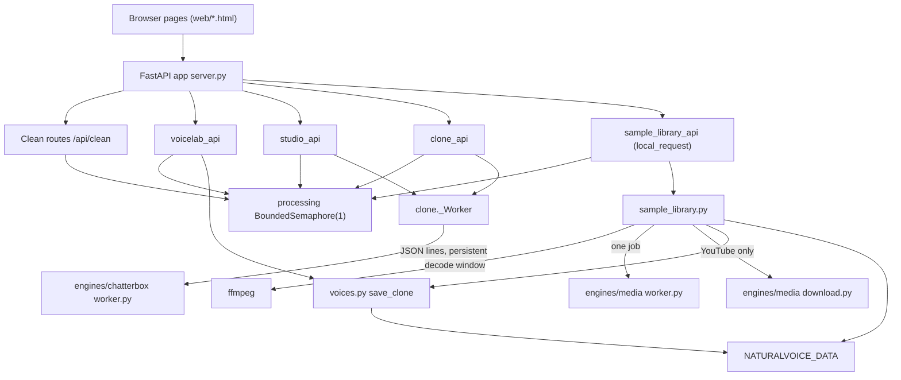

# System Overview

> Category: Architecture | Version: 1.0 | Date: October 2026 | Status: Active

For maintainers who need the runtime shape of Voice Studio: which processes exist, how the workspaces map to routers, where the single processing semaphore sits, and what boundary protects the sample collection API.

**Related:**
- [`../data/storage-layout.md`](../data/storage-layout.md)
- [`../operations/setup-and-verification.md`](../operations/setup-and-verification.md)
- [`../voices/sample-collections-design.md`](../voices/sample-collections-design.md)
- [`../../../../docs/adr/0001-isolate-the-cloning-engine.md`](../../../../docs/adr/0001-isolate-the-cloning-engine.md)
- [`../../../../docs/adr/0004-isolate-media-analysis-and-version-references.md`](../../../../docs/adr/0004-isolate-media-analysis-and-version-references.md)

Evidence pinned to `dev` at HEAD `0a207b37dc9809791194e8b796c9113351ebfb6e` (working tree not hashed). Line references were re-read for this document.

---

## Why this shape exists

Voice Studio is a single local FastAPI application that serves both the browser UI and the JSON API from one process. Two heavyweight engines cannot share its interpreter: the main environment pins ONNX Runtime 1.19.2 for Intel macOS, which cannot load the Chatterbox-Turbo model (ADR 0001), and the media analysis stack (sherpa-onnx, yt-dlp) was isolated so root dependencies stay untouched (ADR 0004). Each engine therefore lives in its own Python 3.12 virtual environment under `engines/` and is reached only through a subprocess.

## Processes

| Process | Started by | Lifetime | Protocol |
|---|---|---|---|
| Main app (uvicorn + FastAPI) | `voicestudio serve`, default host `127.0.0.1`, port `8765` (`src/naturalvoice/cli.py:78-80`, `src/naturalvoice/cli.py:156`) | Until stopped | HTTP |
| Chatterbox cloning worker | `_Worker._start` via `subprocess.Popen` on `engines/chatterbox/.venv/bin/python worker.py` (`src/naturalvoice/clone.py:132-145`) | Persistent; killed after `NATURALVOICE_CLONE_IDLE` seconds idle, default 600 (`src/naturalvoice/clone.py:28`, `src/naturalvoice/clone.py:161-171`) | JSON lines on stdin/stdout with request ids; id `0` is the load handshake (`src/naturalvoice/clone.py:146`, `engines/chatterbox/worker.py:132-135`) |
| Media worker | `process_source` via `subprocess.run` on `engines/media/.venv/bin/python worker.py` (`src/naturalvoice/sample_library.py:231-240`) | One job per process, 900 s timeout | One JSON request line on stdin, one JSON result on stdout (`engines/media/worker.py:107-110`) |
| YouTube downloader | `download` via `engines/media/download.py` in the media venv (`src/naturalvoice/sample_library.py:179-213`) | One download, 300 s timeout | CLI arguments; output file `input.<ext>` |
| ffmpeg | Sample import decode (`src/naturalvoice/sample_library.py:141-176`) and other audio paths (unverified beyond this call site) | Per call, 90 s timeout for sample decode | CLI |

The Chatterbox worker is guarded by a `threading.Lock`, so calls are serialized; a timeout or EOF kills the worker and raises `RuntimeError` (`src/naturalvoice/clone.py:111-130`, `src/naturalvoice/clone.py:173-190`). The media worker writes `dialogue.wav` next to its input before diarization (`engines/media/worker.py:69`) and its stderr/stdout never reach users: failures become a fixed error message (`src/naturalvoice/sample_library.py:249-256`).

## Workspaces and routers

The browser pages are static files under `src/naturalvoice/web` (`index.html`, `studio.html`, `voicelab.html`, `samples.html`), mounted at `/` last so routers win (`src/naturalvoice/server.py:229`, `src/naturalvoice/server.py:245`). Clean is implemented directly in `server.py` (`/api/clean`, `/api/jobs/...`, `/api/batch-download`, `server.py:58-203`). The feature routers are registered in this order (`src/naturalvoice/server.py:234-243`):

| Router | Prefix | Workspace |
|---|---|---|
| `voicelab_api` | `/api/voicelab` (`voicelab_api.py:21`) | Voice Lab |
| `studio_api` | `/api/studio` (`studio_api.py:24`) | Studio |
| `clone_api` | `/api/clone` (`clone_api.py:28`) | Voice Lab cloning, voice conversion |
| `sample_library_api` | `/api/samples` (`sample_library_api.py:83`) | Voice Lab > Voice sample collections |
| `rewrite_api`, `scriptgen_api`, `llm_api` | `/api/rewrite`, `/api/scriptgen`, `/api/llm` | Studio script helpers |

## The single processing semaphore

`server.processing` is a `threading.BoundedSemaphore(1)` (`src/naturalvoice/server.py:31`). Every heavy job acquires it non-blockingly and returns HTTP 429 when busy: Clean (`server.py:93-94`), Studio renders (`studio_api.py:172-176`), Voice Lab jobs (`voicelab_api.py:31-36`), cloning jobs (`clone_api.py:148-153`) and sample imports and retries (`sample_library_api.py:159-160`, `sample_library_api.py:222-223`). Release happens in the background thread's `finally` (for example `server.py:137-138`, `sample_library_api.py:105-109`). There is no queue; the browser retries.

Not every endpoint takes it: `/api/speak` synthesizes inline without acquiring the semaphore (`server.py:206-226`), and sample `add_sample`, `build_version` and `activate` use only the filesystem lock (`sample_library.py:286`, `sample_library.py:337`, `sample_library.py:376`). The semaphore is per process; cross-process safety for sample collections comes from `fcntl.flock` (`sample_library.py:80-89`).

## Sample API boundary

Every `/api/samples` route depends on `local_request` (`src/naturalvoice/sample_library_api.py:83`). It requires a loopback client address, a `localhost`, `127.0.0.1` or `::1` host, a matching `Origin` when present, and rejects `Sec-Fetch-Site: cross-site` (`sample_library_api.py:23-34`). The `SampleUploadLimit` middleware applies the same check to `POST /api/samples/sources` before the body is parsed and caps it at 250 MB plus 64 KB (`sample_library_api.py:37-80`, registered at `server.py:232`). This is not authentication; other routers have no equivalent check (`server.py:234-243` registers them without dependencies), so binding the server to a non-loopback host exposes them.

## Component diagram

Arrows mean "calls or spawns". Grouping is logical, not a deployment tier.

Studio calling the cloning worker for cloned voices is inferred from `clone.speak` existing (`src/naturalvoice/clone.py:343`); the exact Studio call site was not traced (unverified).
