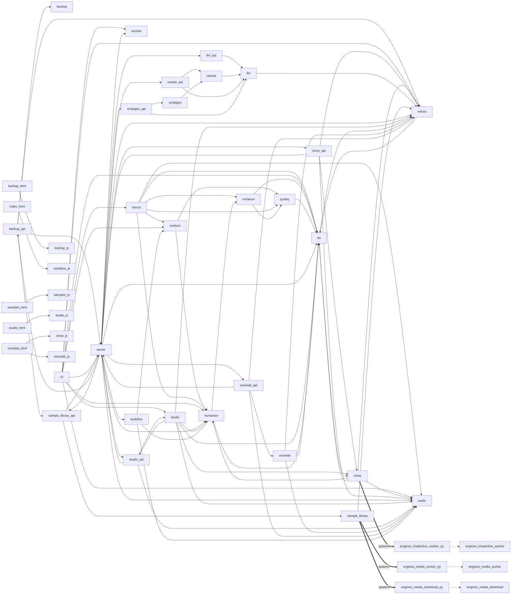

# Code graph overview

Generated by `scripts/code_graph.py` from source; do not edit by hand. Full node and edge list:
[code-graph.json](code-graph.json). Regenerate with `uv run python scripts/code_graph.py --write`;
run it without `--write` to check that the files are current.

This is a static view: Python is parsed with `ast`, and web scripts are scanned for literal `api/`
paths (including relative paths joined to a bare `/api/<area>` base). Computed URLs, dynamic
dispatch and runtime behaviour are not shown, so a route with no `requests` edge may still be used.
`requests` edges match by path, not HTTP method: a script that calls a path links to every method
served there.

| Nodes | Count |
|---|---|
| class | 35 |
| function | 366 |
| module | 32 |
| page | 5 |
| process | 3 |
| route | 73 |
| script | 7 |

| Edges | Count |
|---|---|
| calls | 202 |
| defines | 401 |
| imports | 81 |
| loads | 6 |
| requests | 69 |
| runs | 3 |
| serves | 73 |
| spawns | 3 |

## Modules, engine processes and web assets

Module imports, process spawns and page script loads. Symbol, route and call edges are in the JSON.

