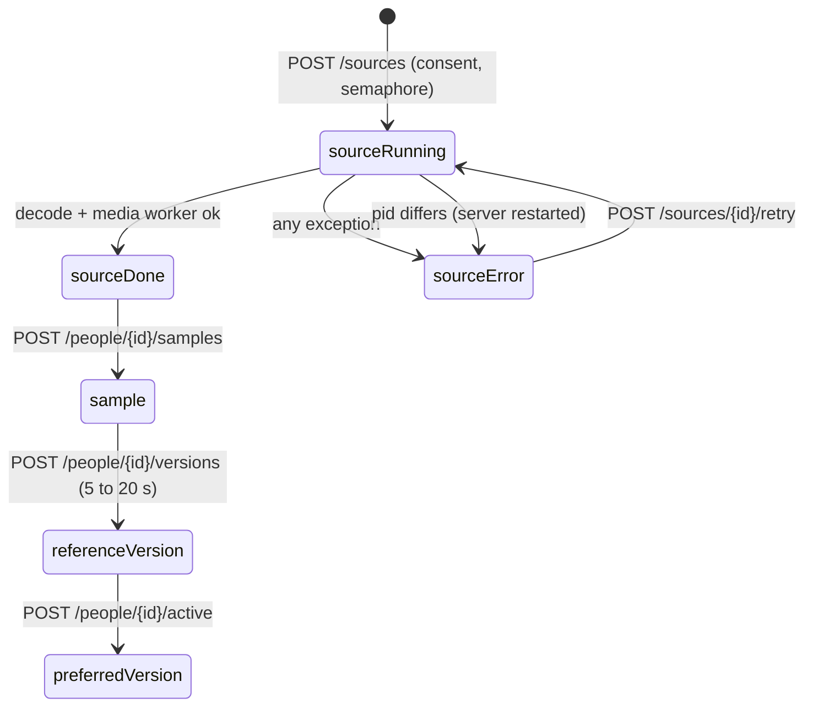

# Sample Collections Design

> Category: Voices | Version: 1.0 | Date: October 2026 | Status: Active

For maintainers changing Voice sample collections: how a source becomes reviewed samples, then a reference version (a cloned voice), then a preferred version, with limits, failure handling and honest non-goals.

**Related:**
- [`../architecture/system-overview.md`](../architecture/system-overview.md)
- [`../data/storage-layout.md`](../data/storage-layout.md)
- [`../operations/setup-and-verification.md`](../operations/setup-and-verification.md)
- [`../../../../docs/sample-collections.md`](../../../../docs/sample-collections.md)
- [`../../../../docs/adr/0004-isolate-media-analysis-and-version-references.md`](../../../../docs/adr/0004-isolate-media-analysis-and-version-references.md)
- [`../../../../docs/adr/0001-isolate-the-cloning-engine.md`](../../../../docs/adr/0001-isolate-the-cloning-engine.md)

Evidence pinned to `dev` at HEAD `0a207b37dc9809791194e8b796c9113351ebfb6e`.

---

## Why this exists

Cloned voices are reference recordings consumed by Chatterbox, which uses about 5 to 20 seconds of conditioning audio (ADR 0004; `REF_KEEP = 20.0` at `src/naturalvoice/clone.py:30`). Sample collections let a user gather a permitted person's speech from several recordings and assemble better references over time without overwriting earlier ones. More audio grows the collection, never model weights: each reference version is tagged `method: reference-selection-not-training` (`src/naturalvoice/sample_library.py:370`).

## Data flow

**Import.** `import_source` requires consent, exactly one of file or YouTube URL, a valid window and 0 to 16 speakers, an installed engine and a free semaphore, then checks capacity (`src/naturalvoice/sample_library_api.py:139-162`). It streams the upload to `sources/<id>/input<ext>`, writes a `running` record carrying the server `pid`, and hands the semaphore to a background thread (`sample_library_api.py:163-196`, `sample_library_api.py:104-112`). It returns 202 with the id; the client polls.

**Analysis.** `process_source` downloads YouTube audio if needed, decodes the window with ffmpeg to stereo 44.1 kHz PCM16 `original.wav`, then runs the media worker once (`sample_library.py:220-240`). The worker optionally separates vocals with Spleeter, always writes `dialogue.wav`, diarizes with pyannote segmentation and 3D-Speaker embeddings, and marks each turn whose span intersects another speaker's (`engines/media/worker.py:65-104`). The parent validates the result (duration up to 121 s, at most 2000 segments, speaker index below 100) before publishing `done` (`sample_library.py:241-248`).

**Sample.** `add_sample` requires consent and a 0.5 to 60 second range inside a completed source, rejects any range where two different speakers' turns overlap each other inside it, reads from `dialogue.wav` or `original.wav`, downmixes to mono and rejects silent audio (`sample_library.py:281-306`). It stores `audio.wav` and a record with source provenance, `rms_db` and a `clipped` flag (`sample_library.py:307-325`). Speaker labels are never stored on the sample: the user assigns the person.

**Reference version.** `build_version` takes 1 to 40 distinct samples of one person totaling 5 to 20 seconds, resamples each to 24 kHz, applies short fades, concatenates, and calls `voices.save_clone` with the next `reference_version` number (`sample_library.py:334-372`). The result is an ordinary `clone:<id>` voice named `<name> v<n>`, immediately usable in Voice Lab and Studio.

**Preferred version.** `activate` sets the person's `active` field to one of their versions (`sample_library.py:375-382`). It is collection metadata only; saved Studio projects keep whatever voice id they already reference (ADR 0004).

## Limits

| Limit | Value | Source |
|---|---|---|
| Upload | 250 MB | `sample_library.py:31`, middleware `sample_library_api.py:53-72` |
| YouTube | HTTPS canonical video ids only, at most 30 min, not live, 300 s timeout, 1 retry | `sample_library.py:110-131`, `:192-212` |
| Window | start 0 to 28,800 s, length 5 to 120 s | `sample_library.py:134-138` |
| ffmpeg decode | 90 s; protocols `file,pipe` only | `sample_library.py:148-149`, `:173` |
| Media worker | 900 s | `sample_library.py:239` |
| Sample | 0.5 to 60 s | `sample_library.py:284` |
| Version | 1 to 40 samples, 5 to 20 s total | `sample_library.py:335-344` |
| Store | 2 GB budget, 1 GB free disk reserve | `sample_library.py:92-100` |

## Failure handling

Before acceptance, any failure removes the new source folder and releases the semaphore (`sample_library_api.py:197-203`). After acceptance, any analysis exception publishes `status: error` with a fixed message and keeps the recordings; subprocess output is never exposed (`sample_library.py:249-257`). A `running` record whose `pid` differs from the current process is reported as interrupted (`sample_library.py:260-264`), and only error or interrupted sources can be retried (`sample_library_api.py:214-233`). API errors map `KeyError` to 404, `ValueError` to 400 and `OSError` to 507 (`sample_library_api.py:86-95`). A crash between writing audio and its record leaves an orphan file, never a corrupted old one (`sample_library.py:53-63`).

## Non-goals

- **No model training.** Versions select reference audio only (`sample_library.py:370`); training was deferred by the owner (ADR 0004).
- **No automatic cross-source identity.** Speaker numbers are per source; people are created and assigned manually (`sample_library.py:267-278`, `:281`).
- **No per-person separation of simultaneous speech.** Spleeter separates vocals from accompaniment only (`engines/media/worker.py:35-62`). Detected overlaps block saving, but a missed overlap is not detected.
- **No editing or deletion** of sources, samples or people through the API (routes `sample_library_api.py:115-305`).
- **Live YouTube downloading is unverified.** Tests do not exercise it against the network; availability depends on yt-dlp and YouTube (unverified).
- **Not authentication.** The loopback and same-origin check is a boundary, not access control (`sample_library_api.py:23-34`).

## Known sharp edges

Deleting a cloned voice through `voices.delete` does not clear a person's `active` pointer (`voices.py:147-152`; `activate` validates only at write time, `sample_library.py:378`). `versions()` reads `meta["reference_version"]` for any voice carrying `sample_person` (`sample_library.py:331`, `:355`), so hand-edited clone metadata without that key would raise.
